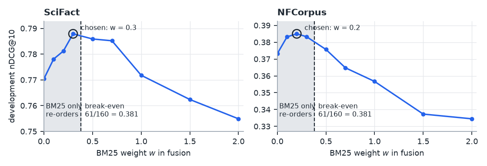

# Hybrid Sparse–Dense Retrieval for Scientific Question Answering

[](https://github.com/Vivansh-07/hybrid-retrieval-qa/actions/workflows/tests.yml)
[](https://github.com/Vivansh-07/hybrid-retrieval-qa/actions/workflows/paper.yml)
[](https://github.com/Vivansh-07/hybrid-retrieval-qa/actions/workflows/paper_full.yml)

**The paper:** *Improving Evidence Retrieval for Scientific Claim Verification: In-Domain
Fine-Tuning with Analytically Weighted Rank Fusion*. The source is in [`paper_full/`](paper_full/):
about 40 pages, APA 7 references, pseudocode for every algorithm and a worked example for every
equation. GitHub builds the PDF (Actions → paper_full → artifact). A shorter 12-page version of
the earlier ablation is in [`paper/`](paper/).

**[RESULTS.md](RESULTS.md)**: every experiment in order, with its command, its output and the
decision it led to.
**[docs/DEPLOY.md](docs/DEPLOY.md)**: run it on your own computer, step by step (tested in a
fresh copy).

## The one thing this project improves

Literature assistants such as SciSpace, ResearchRabbit and Consensus answer questions or map
papers. ResearchRabbit maps citations and does not answer questions. Consensus and SciSpace do
answer with citations, but they are closed products that publish neither how their retrieval
works nor how often it misses the evidence. Every assistant of this kind depends on one step:
**retrieving the passages that contain the evidence**. An answer can be no better than what
was retrieved. This project takes only that step, improves it, explains why the improvement
works, and measures it openly, stage by stage, with a significance test for every comparison.
It runs offline on a laptop with a 4 GB GPU.

**The improvement.** It has two parts, and no reranker is needed:

1. Fine-tune the small dense encoder (all-MiniLM-L6-v2) on the dataset's own training claims.
2. Fuse it with BM25 by weighted Reciprocal Rank Fusion. The BM25 weight is set *below* the
   break-even weight (k + 1)/(k + K) = 61/160 ≈ 0.38, which is derived in the paper
   (Proposition 1). Below it, BM25 cannot add a passage to the list; it can only re-order the
   encoder's candidates.

| nDCG@10 on the test queries | SciFact (300 claims) | NFCorpus (323 queries) |
|---|---|---|
| Standard pipeline: BM25 + dense fusion, then a cross-encoder reranker | 0.715 (329 ms) | 0.358 (168 ms) |
| **Improved:** fine-tuned encoder + BM25 below break-even, no reranker | **0.759** (114 ms) | 0.350 (29 ms) |
| Difference (paired bootstrap) | +0.043, p = 0.003 | −0.008, p = 0.35 (level) |

On SciFact the improved retriever is significantly better than the standard pipeline at about a
third of the cost. On NFCorpus, the second dataset, it is statistically level with the reranked
pipeline at about a sixth of the cost. Fine-tuning helps less there because NFCorpus's
plain-language queries are weaker training labels, while the weighted fusion transfers
unchanged. On both datasets the weight chosen on development queries falls below the
break-even line:



---

## The pipeline and the ablation behind it

```
query
  ├── BM25 over an inverted index ─────────┐
  │     exact terms, codes, rare entities  │
  │                                        ├──► Reciprocal Rank Fusion
  └── Dense bi-encoder + FAISS ────────────┘         (rank-level, k = 60)
        paraphrase, semantic similarity                      │
                                                             ▼
                                              Cross-encoder reranking
                                              (full attention, top-50 only)
                                                             │
                                                             ▼
                                              Grounded answer with citations
```

This is the standard pipeline that the improvement replaces. The improvement came out of an
ablation of it on SciFact: BM25 alone, dense alone, fusion, and fusion + reranking, over one
fixed corpus and index, which asks which retrieval strategy helps which kind of question and
what each stage costs. A manual failure analysis of what still goes wrong completes it. The
ablation's results are [below](#ablation-results-scifact).

---

## Quick start

```bash
git clone https://github.com/Vivansh-07/hybrid-retrieval-qa.git
cd hybrid-retrieval-qa
python -m venv .venv
.venv\Scripts\activate                              # Windows (Command Prompt)
# source .venv/bin/activate                          # Linux / macOS
python -m pip install torch --index-url https://download.pytorch.org/whl/cu126   # GPU build
python -m pip install -r requirements.txt
python -m pip install -e .

python -m pytest tests/ -q                           # 181 tests

# full four-way ablation + sweeps (downloads SciFact + models on first run, ~13 min on an RTX 3050)
python scripts/run_ablation.py --sweep-depth 10 25 50 100 --sweep-fusion-k 10 30 60 100

# figures for the paper
python scripts/make_plots.py

# one ad-hoc question, with a cited answer
python -m hybridqa.cli query "Does vitamin D supplementation reduce respiratory infections?" --answer

# interactive web demo: four strategies side by side + cited answer (http://127.0.0.1:7860)
python scripts/demo.py
python scripts/demo.py --best                        # the best system (fine-tuned encoder + weighted fusion)

# the second dataset (NFCorpus): the five commands are in RESULTS.md, step 15
```

Downloads (SciFact, models) are cached inside the project in `data/hf_cache/`, not in
your user profile. **Step-by-step instructions, expected output and a presentation
script:** [docs/RUN_AND_PRESENT.md](docs/RUN_AND_PRESENT.md).

If `torch.cuda.is_available()` is `False`, everything still runs on CPU — expect the
dense indexing step to take a few minutes instead of seconds.

---

## Ablation results (SciFact)

SciFact test set, 300 claims, from `results/ablation.csv` (RTX 3050 Laptop GPU). Latency
is approximate: it varied up to about 2x between identical runs.

| Variant | nDCG@10 | Recall@10 | MRR@10 | ms/query |
|---|---|---|---|---|
| BM25 | 0.656 | 0.784 | 0.623 | 80 |
| Dense (all-MiniLM-L6-v2) | 0.679 | 0.815 | 0.641 | 22 |
| RRF fusion | 0.710 | 0.833 | 0.675 | 119 |
| + cross-encoder rerank | 0.715 | 0.833 | 0.685 | 329 |

Paired bootstrap on nDCG@10 (10,000 resamples, `results/significance.json`):

- Dense vs BM25: not significant (p = 0.25). The two are tied, but succeed on different claims.
- Fusion vs BM25 and vs dense: significant (p < 0.0001 and p = 0.019).
- Reranker vs fusion: not significant (p = 0.65), at about 3x the latency.

With a stronger dense encoder (`BAAI/bge-small-en-v1.5`, `results/dense_bge_small/`):

| Variant | nDCG@10 | vs MiniLM run |
|---|---|---|
| Dense | 0.723 | +0.044, p = 0.002 |
| RRF fusion | 0.721 | +0.012, not significant |
| + rerank (ms-marco-MiniLM) | 0.712 | not significant |
| + rerank (bge-reranker-base) | 0.714 | not significant, about 1.3 s/query |

Here dense clearly beats BM25 and fusion adds nothing over dense alone: the fusion gain
depends on the two retrievers being of similar strength. Neither reranker helps.

With the MiniLM encoder **fine-tuned on SciFact's training claims** (`scripts/finetune_dense.py`:
contrastive loss, 689 training claims, 120 dev claims for early stopping, no test claim seen;
`results/dense_minilm_finetuned/`):

| Variant | nDCG@10 | Recall@10 | vs before fine-tuning |
|---|---|---|---|
| Dense | **0.742** | 0.886 | +0.063, p < 0.0001 |
| RRF fusion | 0.731 | 0.888 | +0.022, p = 0.013 |
| + cross-encoder rerank | 0.725 | 0.848 | not significant |

Fine-tuning is the largest gain of any change tried, at no extra query cost. The 6-layer
fine-tuned model is statistically level with the larger off-the-shelf BGE-small (p = 0.23).

**Best system:** the fine-tuned encoder fused with BM25 at a BM25 weight of 0.3, chosen on
held-out development claims (`scripts/tune_fusion.py`): **nDCG@10 0.759, Recall@10 0.905**,
significantly better than equal-weight fusion (p = 0.0009) and than the original
pipeline (+0.043, p = 0.003). Results in `results/dense_minilm_finetuned__fusion_weighted/`.
Every run is recorded in [docs/EXPERIMENT_LOG.md](docs/EXPERIMENT_LOG.md).

**Failure analysis** of the 40 hardest claims (`results/failure_analysis.csv`): missing
evidence in the gold abstract 42%, terminology mismatch 28%, reranker error 20%, ambiguous
claim 10%. **Answer quality** (100 answers, 0-2 rubric, `results/answer_quality.json`): the
generative reader is more often correct (0.84 vs 0.48) but less faithful (1.16 vs 2.00)
than the extractive one. Both were labelled/scored by an AI assistant following fixed
rubrics (see the paper and `docs/ANSWER_RUBRIC.md`).

**Further checks** (details in the experiment log):
- At a BM25 weight of 0.3, BM25 only re-orders the dense retriever's top 100 and never
  adds a document: a passage found only by BM25 scores at most 0.3/61, below the dense
  retriever's 100th passage (1/160). Only 2 test claims lose their gold abstract this way.
- Could the reader abstain when retrieval failed? The top cross-encoder score predicts
  whether a gold abstract reached the reader with AUC 0.81, but the threshold chosen on
  the dev claims catches 68 of 74 misses only by refusing 109 of 226 answerable claims
  (`scripts/abstention.py`).
- The best system, fine-tuning included, reproduces exactly from a fresh clone.

---

## Repository layout

```
RESULTS.md               every experiment in order: command, output, decision
configs/scifact.yaml     every hyperparameter for every stage, in one file
src/hybridqa/
  config.py              YAML loading, dotted-path lookup, single-key override
  data.py                BEIR loading, sentence-window chunking, chunk→doc mapping
  sparse.py              BM25 retriever (rank_bm25) with the project's tokenisation
  dense.py               bi-encoder + FAISS flat inner-product index, cached embeddings
  fusion.py              Reciprocal Rank Fusion, plus a score-fusion baseline
  rerank.py              cross-encoder reranking over the fused candidate pool
  abstention.py          AUC and threshold for the abstention check
  scoring.py, subsets.py, significance.py   answer scores, claim subsets, paired tests
  answer.py              extractive / generative answering with citations
  metrics.py             Recall@k, P@k, MRR, nDCG@k, paired bootstrap
  pipeline.py            builds indexes once, serves all four ablation variants
  cli.py                 `python -m hybridqa.cli {ablation,query,answer}`
scripts/
  run_ablation.py        the four variants + rerank-depth and RRF-k sweeps
  make_plots.py          results/*.json → paper/figures/*.png
  failure_analysis.py    the 40 hardest claims as a worksheet; --summarize; --markdown (review sheet)
  demo.py                Gradio web demo: one question, all four variants side by side; --best, --offline
  pick_demo_claims.py    claims worth showing in the demo (where the variants disagree)
  abstention.py          could retrieval confidence tell the reader to abstain? (AUC, threshold)
  finetune_dense.py      contrastive fine-tuning of the dense encoder on SciFact train claims
  significance.py        recompute significance.json from saved runs
  compare_runs.py        paired comparison of a one-change run against the main results
  check_rerun.py         is a re-run (e.g. results/_live) identical to the committed results?
  fix_slide_fonts.py     downloaded deck → a copy with fonts every Windows PC has (docs/SLIDES.md)
  significance_nfcorpus.py  paired tests of the improvement on the second dataset (NFCorpus)
  tune_fusion.py         choose the BM25 fusion weight on held-out dev claims
  rewrite_progress.py    which chapters of the full paper are still the AI-assisted draft; given one (e.g. 03), its sections
  overlap_check.py       plagiarism pre-check: runs of 8+ words the full paper shares with other texts
  query_subsets.py       which retriever helps which kind of claim (overlap, numbers, rare terms)
  answer_sheet.py        blind sheet for hand-scoring the generated answers; --summarize
  make_survey_docx.py    docs/LITERATURE_SURVEY.md → paper/Literature_Survey.docx
  make_problem_statement.py  builds docs/Problem_Statement.pdf
  make_docx.py           the full paper as a Word file (pandoc, APA 7); docx_to_pdf.ps1 checks it in Word
tests/                   unit tests: metrics, fusion, config, significance, subsets, scoring,
                         abstention; the paper's references and numbers; the review sheet
paper/                   LaTeX source, bibliography, figures (GitHub builds the PDF: Actions → paper)
paper_full/              the full paper (29 pages, APA references), one file per chapter (Actions → paper_full);
                         word/ holds what scripts/make_docx.py needs for the Word version (APA style, Figure 1)
paper_sncs/              the full paper in the Springer Nature journal template for SN Computer Science, generated by
                         scripts/make_sncs.py from paper_full/ (same chapter files) (Actions → paper_sncs)
docs/
  WORKFLOW.md            the original four-week plan (13 Sep)
  VIVA_PREP.md           expected questions with worked answers
  ANSWER_RUBRIC.md       how the generated answers are scored by hand (fixed in advance)
  DEPLOY.md              run it on your own computer, step by step (tested)
  RUN_AND_PRESENT.md     tested commands, expected output, presentation script, daily plan
  ALGORITHMS.md          every algorithm: the idea, why it was chosen, settings, code
  LITERATURE_SURVEY.md   the survey (40 references, 2022-2026 update); builds the .docx
  FAILURE_REVIEW.md      the 40 failure labels as a review sheet (generated)
  SLIDES.md              the 12 slides: titles, what to say, where each number comes from
  Problem_Statement.pdf  the project explained in plain language
  EXPERIMENT_LOG.md      append one entry per run, including failed ones
  GIT_FOR_BEGINNERS.md   the daily git routine and common errors
```

---

## Design decisions worth knowing before you present this

- **Fusion happens at rank level, not score level.** BM25 scores are unbounded and
  corpus-dependent; cosine similarities are bounded. No fixed weighting of the raw
  numbers transfers across queries, so RRF combines positions instead. `fusion.py`
  also implements min-max score fusion so the paper can show the difference.
- **The cross-encoder never sees the corpus.** It costs one forward pass per
  query–passage pair, so it runs only over the fused top-`rerank.candidates`. That
  parameter is the accuracy/latency dial the paper measures.
- **Chunks are scored, documents are judged.** BEIR relevance is document-level, so
  chunk rankings are collapsed to parent document ids before evaluation and
  de-duplicated. Overlapping chunks therefore cannot inflate the metrics.
- **Metrics are implemented from their definitions** rather than imported, so every
  number is defensible in a viva. `validate_against_pytrec_eval` cross-checks them
  against the standard toolkit if you install `pytrec_eval`.
- **Every headline claim gets a p-value.** With 300 queries a one-point nDCG difference
  is often noise; `run_ablation.py` writes a paired bootstrap test to
  `results/significance.json`.

---

## Reproducibility

Every number in the paper comes from `results/`, produced by the scripts above, and
every run is recorded in [docs/EXPERIMENT_LOG.md](docs/EXPERIMENT_LOG.md). Seeds are
fixed (`evaluation.seed`); on 3 Oct a fresh clone reproduced the best system exactly,
fine-tuning included. Dense embeddings are cached under `data/indexes/`; the file name
hashes the dataset, chunking and encoder settings (and the saved weights of a local
model), so changing any of them re-embeds automatically.

## Tests

```bash
python -m pytest tests/ -q
```

181 tests check the metrics against hand-worked values, the fusion, config, significance,
subset, scoring and abstention code; that the paper's references and figures are intact and
its headline numbers (also those in RESULTS.md, the slides, the problem statement and the full paper) still
match `results/`; that every worked example in the full paper's Methodology still computes
to the number it shows; that the generated documents (failure review sheet, problem statement,
survey) match their sources; and that the demo reads the committed results and the tuned
fusion weight. GitHub runs them on every pull request.

## Data and models

The code is MIT-licensed (below); the data and models it uses keep their own licences.
`results/` and `docs/FAILURE_REVIEW.md` quote SciFact claims and abstract excerpts.

| What | Source | Licence |
|---|---|---|
| SciFact claims and evidence annotations | Wadden et al., EMNLP 2020 ([allenai/scifact](https://github.com/allenai/scifact)), used via BEIR | CC BY 4.0 |
| SciFact abstracts | Semantic Scholar S2ORC | ODC-By 1.0 |
| NFCorpus queries, abstracts and judgements | Boteva et al., ECIR 2016, used via BEIR (`BeIR/nfcorpus`) | CC BY-SA 4.0 (BEIR Hub card) |
| `sentence-transformers/all-MiniLM-L6-v2` | Hugging Face Hub | Apache 2.0 |
| `cross-encoder/ms-marco-MiniLM-L-6-v2` | Hugging Face Hub | Apache 2.0 |
| `google/flan-t5-base` | Hugging Face Hub | Apache 2.0 |
| `deepset/roberta-base-squad2` | Hugging Face Hub | CC BY 4.0 |
| `BAAI/bge-small-en-v1.5`, `BAAI/bge-reranker-base` | Hugging Face Hub | MIT |

Licences as stated by each source on 9 Oct 2026 (NFCorpus: 13 Oct 2026).

## License

MIT — see [LICENSE](LICENSE).
